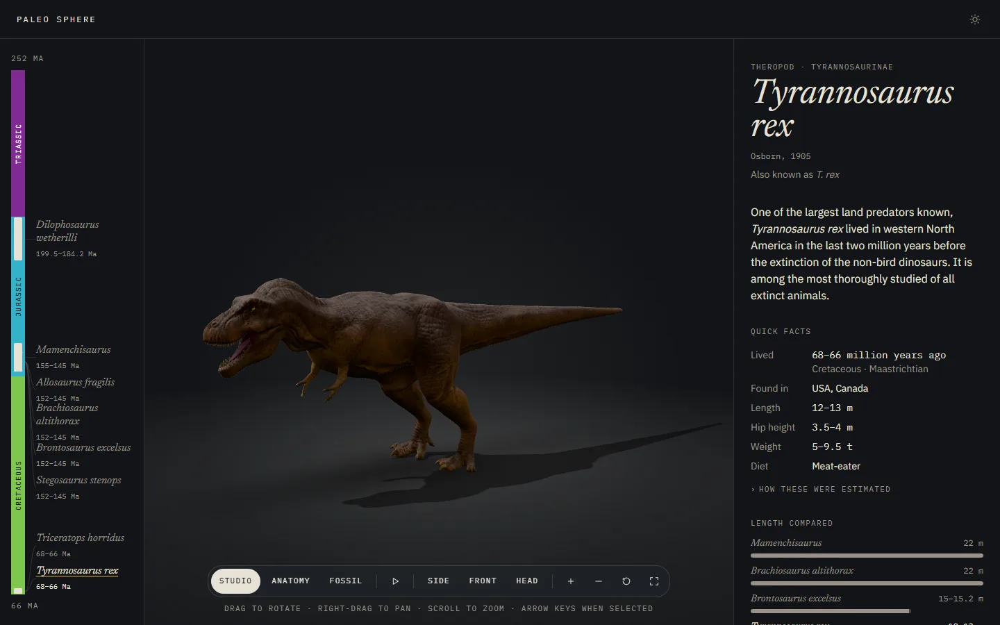
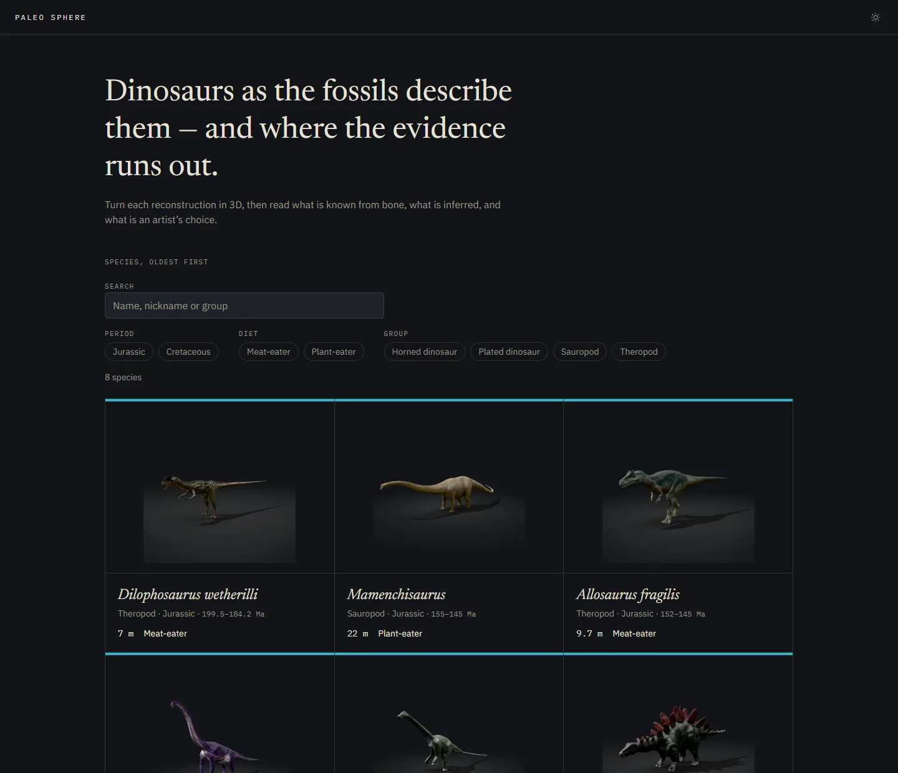
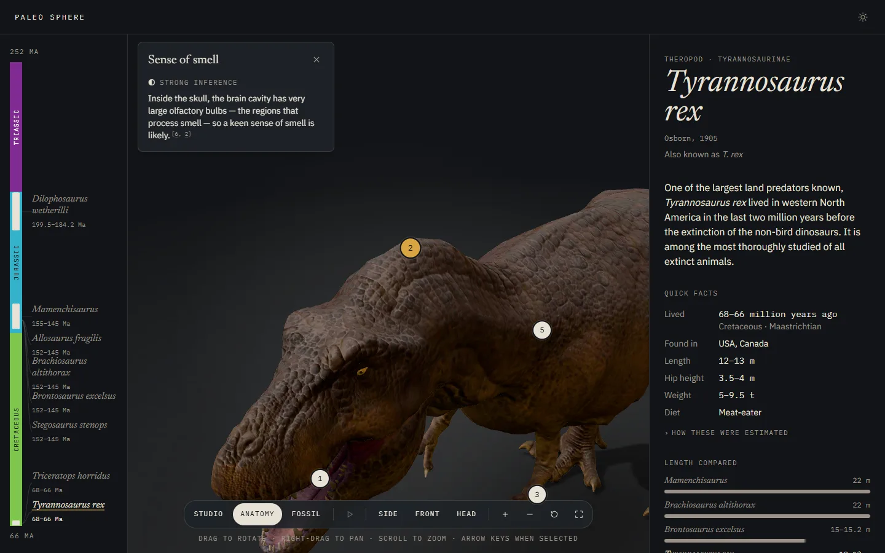
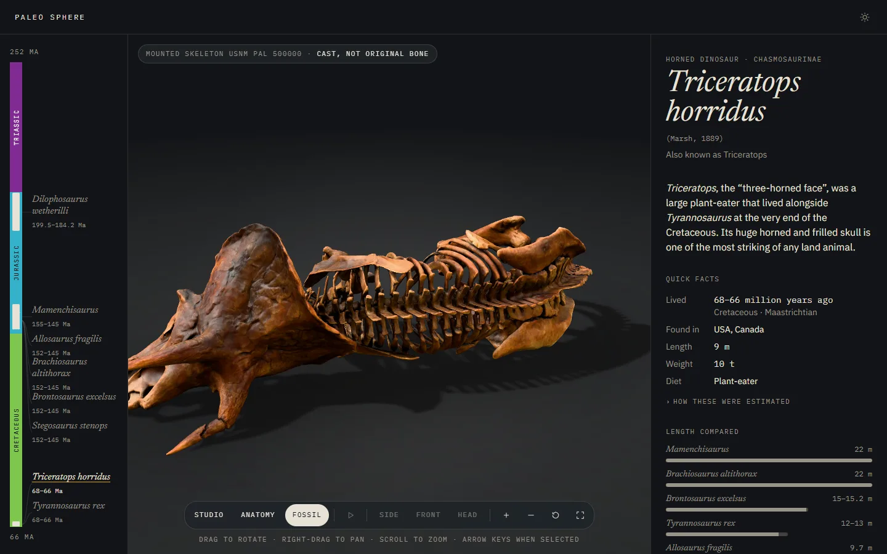
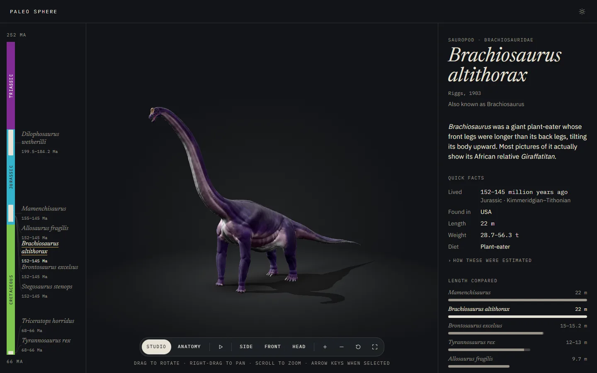
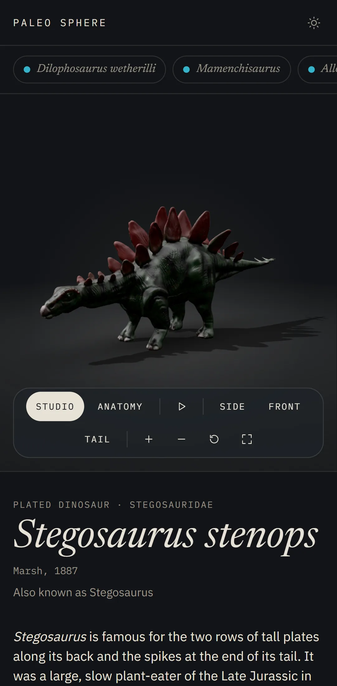

# Paleo Sphere

An interactive 3D dinosaur encyclopedia: realistic reconstructions you can inspect, with sourced science that separates fossil evidence from artistic interpretation.

**[Live Demo](https://paleo-sphere.vercel.app/)**

Independent, non-commercial educational project. Not affiliated with any museum.



## Features

- **3D viewer:** rotate, zoom, pan, camera presets (side, front, head), fullscreen and an optional idle animation. Works with mouse, touch and keyboard.
- **Anatomy mode:** numbered hotspots on the model, each with a short note and its evidence level.
- **Fossil comparison:** switch to a 3D scan of a museum fossil cast (a _T. rex_ skull and a mounted _Triceratops_ skeleton).
- **Sourced content:** every claim is tagged from 1 (direct fossil evidence) to 4 (artistic interpretation) and cites its source. Size estimates are shown as ranges.
- **Species explorer:** a geological timeline, search, and filters by period, diet and group.
- **Accessible and responsive:** all facts are plain HTML, there are dark and light themes, reduced motion is respected, and the layout works on mobile. A poster image replaces the viewer when WebGL isn't available.

**Species:** _Dilophosaurus wetherilli_, _Mamenchisaurus_, _Allosaurus fragilis_, _Brachiosaurus altithorax_, _Brontosaurus excelsus_, _Stegosaurus stenops_, _Triceratops horridus_, _Tyrannosaurus rex_.

## Screenshots

| Species explorer                                | Anatomy hotspots                                      |
| ----------------------------------------------- | ----------------------------------------------------- |
|  |         |
| **Fossil comparison**                           | **Sauropod reconstruction**                           |
|     |  |

<p align="center"></p>

## Tech stack

Next.js (App Router) · React · TypeScript (strict) · Three.js · React Three Fiber · Drei · Tailwind CSS · Zod · Vitest · Playwright. Models are delivered as GLB files with KTX2 textures and Meshopt compression, prepared with headless Blender.

## Getting started

Requires Node.js ≥ 22.12.

```bash
npm install
npm run dev        # http://localhost:3000
```

| Command                  | What it does                                                                               |
| ------------------------ | ------------------------------------------------------------------------------------------ |
| `npm run build`          | Production build. **Fails if any species content file is invalid.**                        |
| `npm run check`          | Typecheck, lint, format check, unit tests                                                  |
| `npm run e2e`            | Playwright tests against a production build (first run: `npx playwright install chromium`) |
| `npm run content:verify` | Checks every species citation against Crossref (DOIs) or the live URL                      |

Preparing new 3D assets also needs Blender 5.1 and KTX-Software 4.4+. See [docs/adding-a-species.md](docs/adding-a-species.md).

## Project layout

```
src/
  app/              routes (server components)
  content/species/  one TypeScript file per species, validated by Zod
  domain/species/   schema, repository, viewer config (no React, no three)
  features/         viewer, explorer, article
  ui/               design-system primitives
tests/e2e/          Playwright specs
docs/               PRD, architecture, research, progress log
```

## Documentation

- [docs/PROGRESS.md](docs/PROGRESS.md): current status and decisions
- [docs/architecture.md](docs/architecture.md): architecture and the reasons behind it
- [docs/adding-a-species.md](docs/adding-a-species.md): content, asset pipeline and rigging
- [docs/research/](docs/research/README.md): per-species research and source checks

## Credits

3D model credits and licenses are shown on each species page and recorded in [docs/asset-research.md](docs/asset-research.md).
