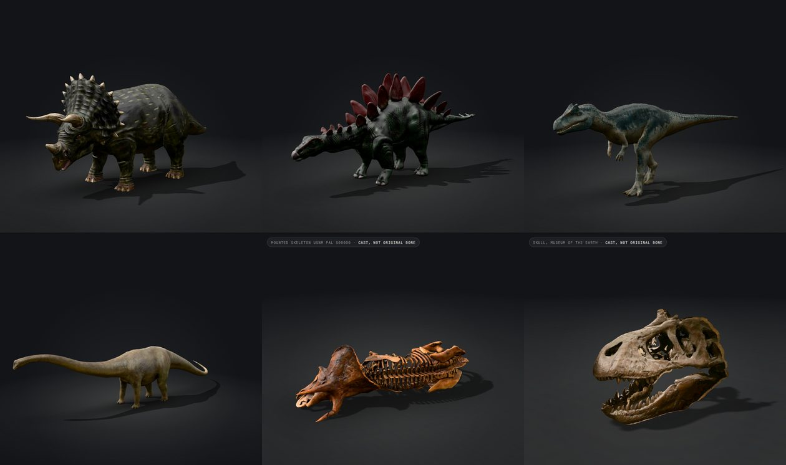
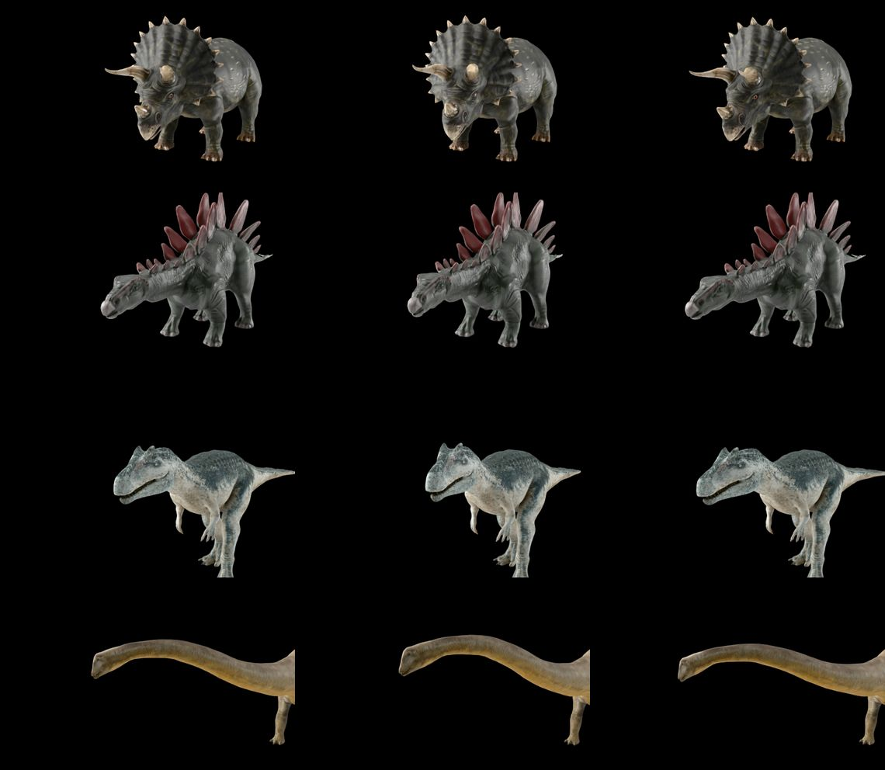
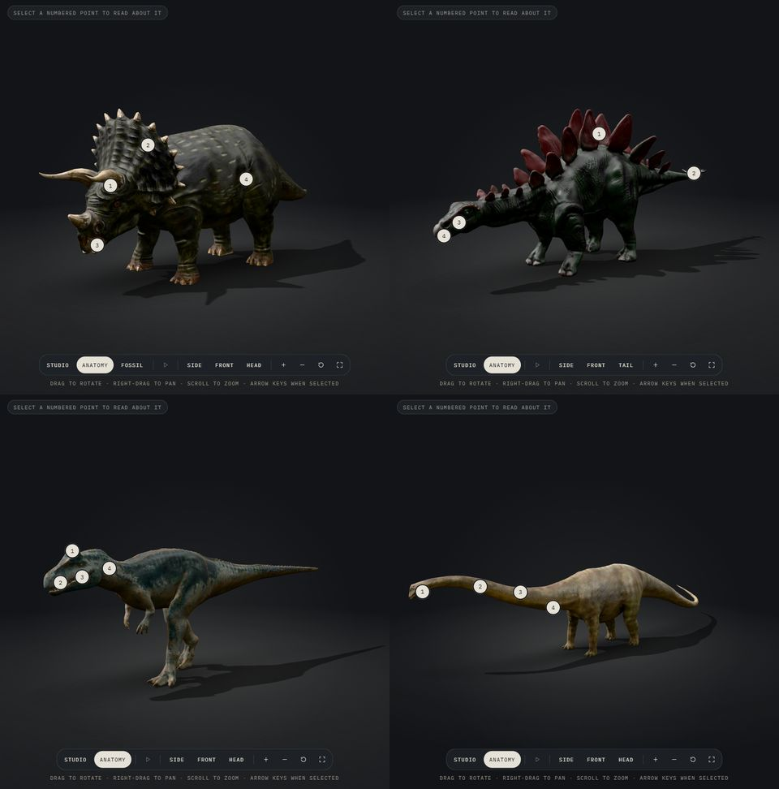

# Species models and fossil scans (2026-10-17)

Four reconstructions and two specimen scans, prepared with `scripts/blender/prepare_model.py` and built with `scripts/build-asset.mjs`. Licences were checked against each download's `license.txt`.

## Preparation

| Model | Source | Licence | Pose | Scaled to | Triangles | High / mobile |
|---|---|---|---|---|---|---|
| *Triceratops horridus* | "Triceratops", DailyArt | CC BY-NC 4.0 | Standing pose as imported; rig dropped | 9 m (box) | 11k | 3.23 / 0.91 MB |
| *Stegosaurus stenops* | "Stegosaurus", PAndras | CC BY 4.0 | Static | 9 m (box) | 50k | 1.76 / 0.92 MB |
| *Allosaurus fragilis* | "Animated Allosaurus (Free)", Anees Animates | CC BY-NC 4.0 | Frame 0 of its walk cycle (the bind pose is a vertical T-pose) | 9.7 m (box) | 96k | 4.13 / 1.84 MB |
| *Mamenchisaurus* | "Mamen River Dragon", DailyArt | CC BY-NC 4.0 | Frame 120 of its animation: neck about level (earlier frames droop it to the ground, later ones raise it high) | 22 m **along the midline** | 21k | 3.53 / 1.48 MB |
| *Triceratops* skeleton (fossil mode) | "Triceratops Horridus Marsh", Smithsonian | CC0 | As mounted, lying on its side | Scan's own units (undocumented) | 150k | 4.83 / 2.46 MB |
| *T. rex* skull (fossil mode) | "Vertebrate: Tyrannosaurus rex skull (MOTE)", Digital Atlas of Ancient Life | CC0 | Static | 1.5 m, the reconstruction's head length | 191k (from 618k) | 2.03 / 1.51 MB |

Lengths come from the cited estimates in each record. The *Mamenchisaurus* pose curves sideways and its tail sweeps round, so a straight box measured 1.24× shorter than the body: `scripts/blender/midline_length.py` sums the skeleton from snout to tail tip (27.06 units against a 21.79-unit box) and the model is prepared at a 17.71 m box so the midline is 22 m. The other three are close to straight from above.

## Specimen facts

- **USNM PAL 500000** is the Smithsonian's mounted *Triceratops*: casts and 3D prints of bones from nine individuals (USNM V 1205, 1208, 2100, 2124, 4800, 4842, 4928, 7423, and the former composite mount USNM V 2580), from the Lance Formation of Wyoming. Source: the NMNH Paleobiology specimen record via GBIF (`api.gbif.org/v1/occurrence/2284132289`), cited as `gbif-usnm-pal-500000`. The Smithsonian's own pages refuse scripted requests (HTTP 403).
- **The skull** is "an artificial cast of a *Tyrannosaurus rex* skull on display at the Museum of the Earth, Ithaca, New York" (the creator's description), cited as `dal-trex-skull-cast`. The original specimen is not named, so no size is claimed.
- The survey first stood the skeleton upright, which was wrong: the mount itself lies on its side, and an upright version would show a pose it was never mounted in.

## Review

| Model | Checked | Notes |
|---|---|---|
| *Triceratops* | Two brow horns, short nose horn (note cites `farke-2009`) | Only 11k triangles; detail comes from the normal map, and the silhouette is soft at close range. Colour and spots labelled as interpretation |
| *Stegosaurus* | Two pairs of tail spikes (`hayashi-2011`), small head (`nhm-stegosaurus`) | The texture is painted very dark (mean 55/255) with red plates; both labelled as interpretation |
| *Allosaurus* | Three-clawed hands and brow horns (`nhm-allosaurus`) | Best detail of the set. Lips, colour and pattern labelled as interpretation. Shown mid-stride |
| *Mamenchisaurus* | Neck posture labelled as uncertain (`taylor-2022`) | Plain texture |
| Fossils | Labelled "Cast, not original bone" on the stage and in the article | Shown in place of the reconstruction, with their own camera |

Pipeline changes made for this set: `prepare_model.py --pose rest|frame:N` freezes a rigged model's pose and drops the rig and the importer's bone display shapes; `--rotate axis:deg` turns a model lying on the wrong axis. `build-asset.mjs` now sets every material non-metallic (two downloads had metallic = 1 with stray metal pixels) and takes `--simplify <ratio>` for dense scans. `scripts/inspect-source.mjs` and `scripts/blender/survey_source.py` give a first look at a download.

## Rigs, idle animation and anatomy (2026-10-17)

The four reconstructions now have what the *T. rex* has: a 12 s idle loop behind the Play button and anatomy markers with cited notes. Same pipeline as the *T. rex* rig test (`tyrannosaurus-rex-rig.md`): our own skeleton on the prepared (displayed) pose, so the rest pose is exactly what visitors see. The downloads' own rigs were not reused: their rest poses are T-poses or other animation frames, and their bone conventions differ.

| Step | Tool | Notes |
|---|---|---|
| Bone placement | `scripts/blender/profile_render.py` + `scripts/profile-grid.mjs` | Orthographic side and top silhouettes with a 0.5 m grid in glTF metres; joints read off them into `rigs/<slug>.json`. The *Mamenchisaurus* body centre is x ≈ 0.9 in its curved pose, so its legs mirror about `mirrorX` |
| Skinning | `rig_model.py` | 23–31 bones. Separate pieces (teeth, eyes, a few internal parts) follow the nearest skin rigidly; the *Allosaurus* teeth and *Triceratops* eyes follow the head |
| Idle | `animate_idle.py`, `rigs/<slug>-idle.json` | Two breaths, a slow look left and right, a tail wave. New `"axes": "armature"`: turns are about the body's vertical and sideways axes, so a head angled steeply down (*Triceratops*) turns without rolling. Quadrupeds keep the chest out of the look so the front feet stay planted; *Stegosaurus* breathes more gently because its plates ride on the chest |
| Check | `pose_test.py --frames 0,69,105,300` | Above. No creasing; frill, plates and teeth move with their bones |
| Web build | `export_glb.py`, `asset:build` | High: *Triceratops* 3.26 MB, *Stegosaurus* 1.86 MB, *Allosaurus* 4.17 MB, *Mamenchisaurus* 3.05 MB (the rig's seam weld removed duplicate vertices) |

Playback on the integrated Radeon 860M (Chrome, 1440 × 900): 60 fps for every species, frame-time median 16.7 ms, p95 ≤ 17.5 ms; 0 fps when paused.

### Anatomy markers

Four markers per species. Every note is a claim already in that species' record, word for word, with its evidence level and sources (no new claims): *Triceratops* horns, frill, beak and cheek teeth, skin; *Stegosaurus* plates, tail spikes, small head, toothless jaw tip; *Allosaurus* brow horns, teeth, skull strength, neck muscle; *Mamenchisaurus* small head, neck length, air-filled neck bones, neck ribs.

Markers sit 4 cm off the surface (`surface_points.py` now prints a `marker` position). Exactly on the surface, half of them were hidden at random: the occlusion test compared two equal distances, and the web build's compressed vertex positions move the surface by millimetres.
