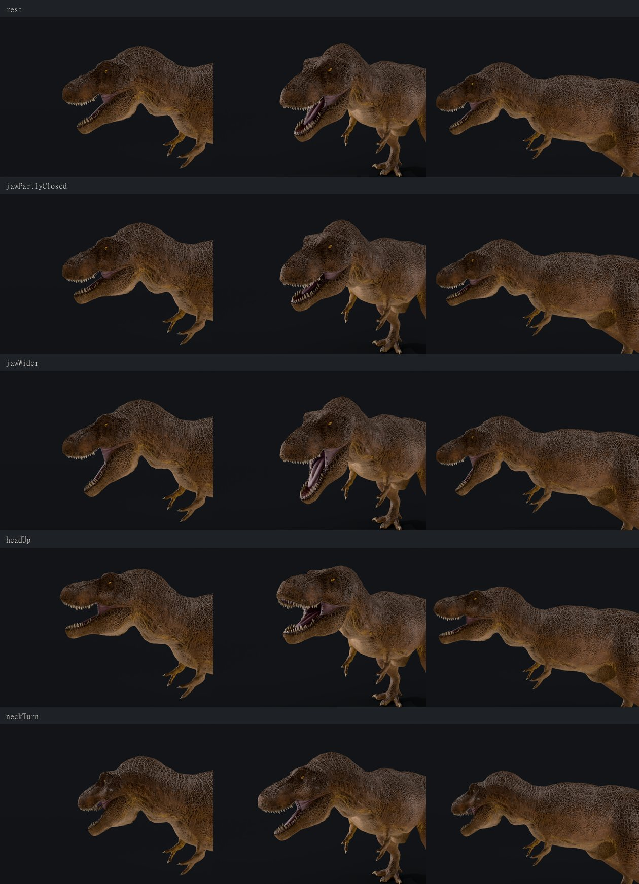
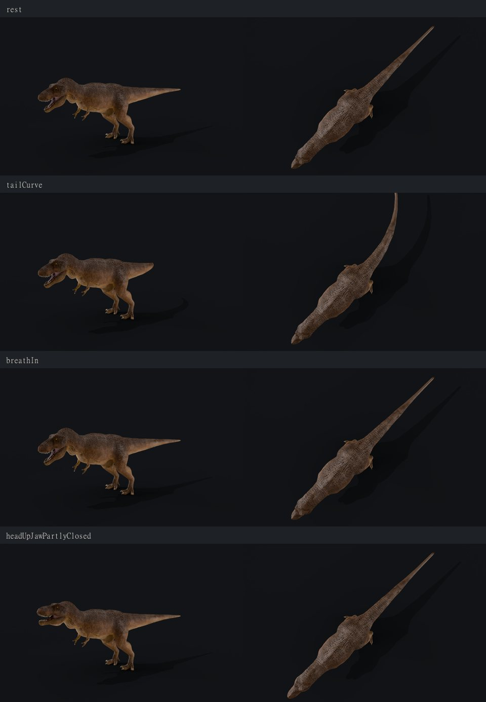
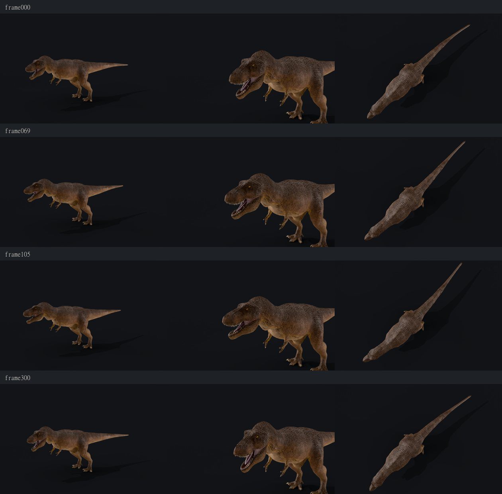

# Rigging test — *Tyrannosaurus rex* (2026-10-16)

**Question:** can the static "Tyrant King" sculpt be rigged well enough for a short, subtle idle animation (breathing, head and neck movement, tail sway, a little jaw motion)?
**Answer: yes, for moderate movement.** A walk cycle was not attempted and is not recommended for this asset.

Everything below is reproducible from the repo; the rigged files live in `assets-src/trex/work/` (git-ignored, CC BY source asset).

## Pipeline

| Step | Command | Result |
|---|---|---|
| 1. Mesh health + joint survey | `scripts/blender/analyze_mesh.py --weld 0.0005` | 1,768 "pieces" and 10,830 open edges as imported. These are mostly glTF splitting vertices along UV seams; after a 0.5 mm weld there are **90 pieces** (body + teeth, claws) and **8 open edges**, which is good for automatic skinning. Slices locate the spine, tail, hips (z ≈ 0.6), legs, arms (z ≈ 3.4–3.9) and head (z 4.3–6.0) |
| 2. Skeleton | `scripts/blender/rigs/tyrannosaurus-rex.json` | 30 bones: root, pelvis, 3 spine, 2 neck, head, jaw, 7 tail, 4 per leg, 3 per arm (right side mirrored) |
| 3. Bind | `scripts/blender/rig_model.py` | Blender automatic weights, then repairs (below); ≤ 4 influences per vertex (three.js limit), normalised |
| 4. Check | `scripts/blender/weight_map.py`, `scripts/blender/pose_test.py`, `scripts/rig-sheet.mjs` | Side-view maps of the dominant bone; Cycles renders of stress poses |
| 5. Export + web build | `scripts/blender/export_glb.py`, then `scripts/build-asset.mjs` | Skin survives Meshopt/KTX2: 4.11 MB (static: 4.09 MB). three.js renders it identically to the static model, no errors |

## Problems found and fixed

| Problem | Cause | Fix |
|---|---|---|
| 2,759 vertices unweighted | Automatic weights skip separate pieces inside the skin (teeth, claws) | Each piece copies the averaged weights of the nearest weighted surface (the gum or toe it sits in), applied uniformly, so a tooth moves rigidly |
| Upper teeth bound to the jaw | Automatic weights bleed across a wide-open mouth | `jawSplit`: head/jaw weight divided along a measured gape line between the tooth rows, 5 cm blend at the lips, faded in over 30 cm behind the mouth corner. Teeth go wholly to the jaw their tip points away from |
| Arm bones influencing the lower jaw | Automatic weights reached through the head | `cleanRegions`: arm influence removed from the head region before the repair step refills it |
| Test renders written to `C:\.lookdev` | Blender resolves relative output paths from the drive root after opening a `.blend` | `pose_test.py` resolves paths before opening the file |

## Stress poses

Rotation conventions (bone-local, verified in renders): **+Z** turns the head toward the animal's left; **−X** raises the neck and head; jaw **−X** closes the mouth, **+X** opens it wider.

| Pose | Verdict |
|---|---|
| Neck and head turned ~30° in total | Smooth; no creasing at the neck base |
| Head raised ~17° | Smooth |
| Jaw partly closed 8° / opened 12° | Upper teeth stay fixed; the lower jaw moves as one piece; the inner mouth stretches cleanly at the corner. Fully closing the mouth is not possible: the sculpt has no closed-lip geometry |
| Tail curved ~50° over its length | Smooth, no segment kinks |
| Breathing (chest scale 5%) | Works; very subtle, which suits an idle |

## Limits

- **Moderate motion only.** Large rotations at the hips and shoulders, and any walking, would expose stretching and the static foot pose.
- **No full mouth closure** (see above); the open mouth also remains the model's resting state.
- Weights were checked with maps and renders, not painted by hand; an animator would refine the shoulder and thigh areas.

## Idle clip (2026-10-16, approved)

| Step | Command | Result |
|---|---|---|
| Motion spec | `scripts/blender/rigs/tyrannosaurus-rex-idle.json` | 12 s loop at 30 fps: two breaths (rib cage ±4.5 %), a slow look left (13°) and right (7°) shared over spine3, neck and head, the jaw closing 4° and opening 2.5°, a tail wave of 1.2–3.2° per bone travelling to the tip. All inside the ranges the stress poses passed |
| Keyframes | `scripts/blender/animate_idle.py` | Every frame keyed from closed-form curves; frame 360 equals frame 0, so the loop has no seam. Breathing scales spine2 and gives spine3 the inverse scale, so the neck, head and arms keep their size (glTF has no "don't inherit scale") |
| Check | `pose_test.py --frames 0,69,105,300` | Below: rest, full inhale, looking left with jaw closing, looking right with jaw open. No creasing at the neck or chest |
| Export + build | `export_glb.py`, `npm run asset:build` (now with `resample()`) | Clip "Idle", 12.0 s. Download 4.09 → 4.13 MB (high), 2.02 → 2.06 MB (mobile) |

No sound. A breathing track synthesised from the same breath timings was tried and removed at review (2026-10-17): it did not sound realistic. A call would contradict the fixed open mouth, and the idle never steps.

## In the viewer

Measured in Chrome on an AMD Radeon 860M (integrated), 1440 × 900:

| State | Frames rendered | Frame time |
|---|---|---|
| Idle / paused | 0 per second | — |
| Playing (shadow map and contact shadow re-rendered each frame) | 60 per second | median 16.7 ms, p95 17.3 ms, 1 of 241 frames over 20 ms |
