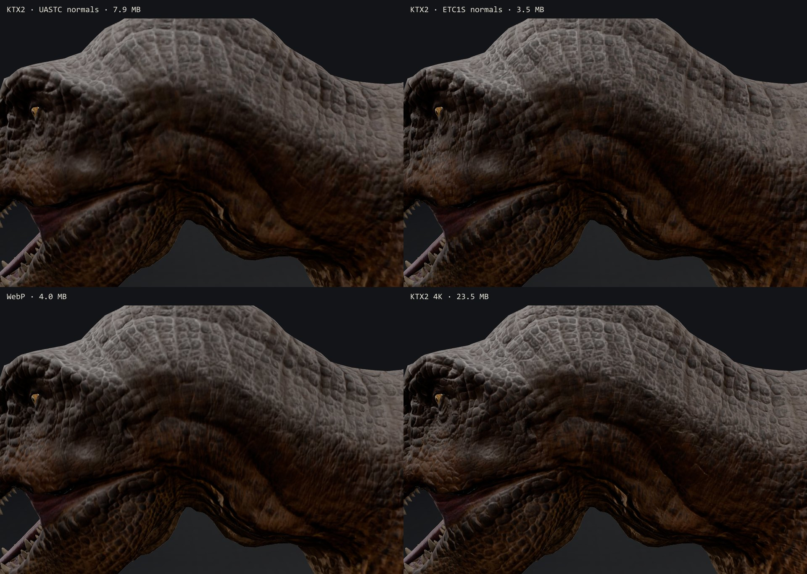
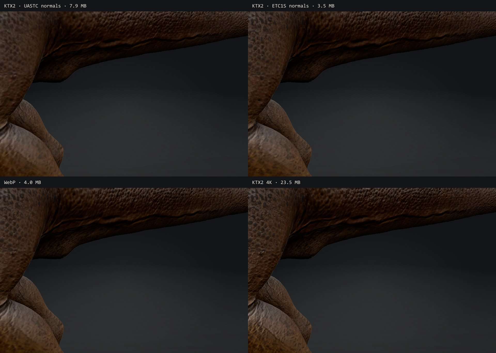
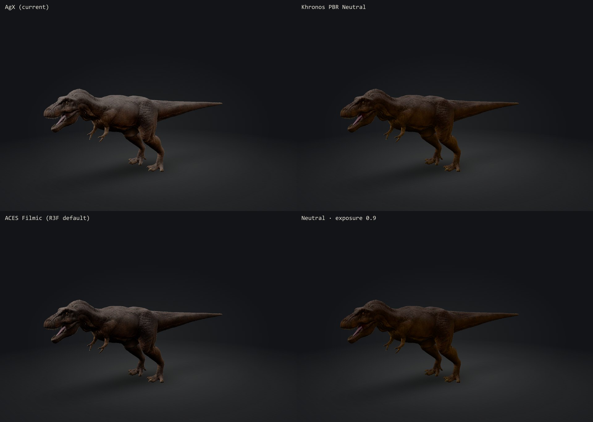
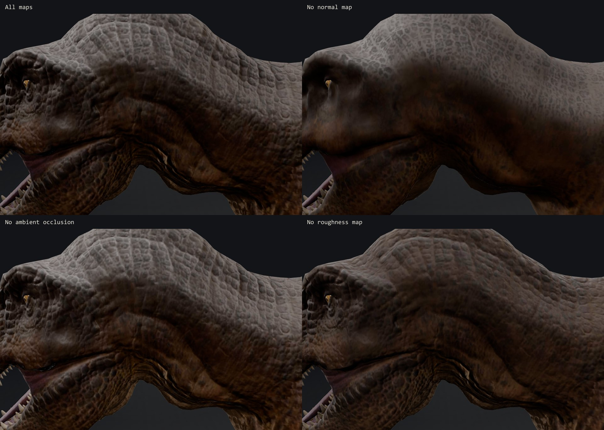
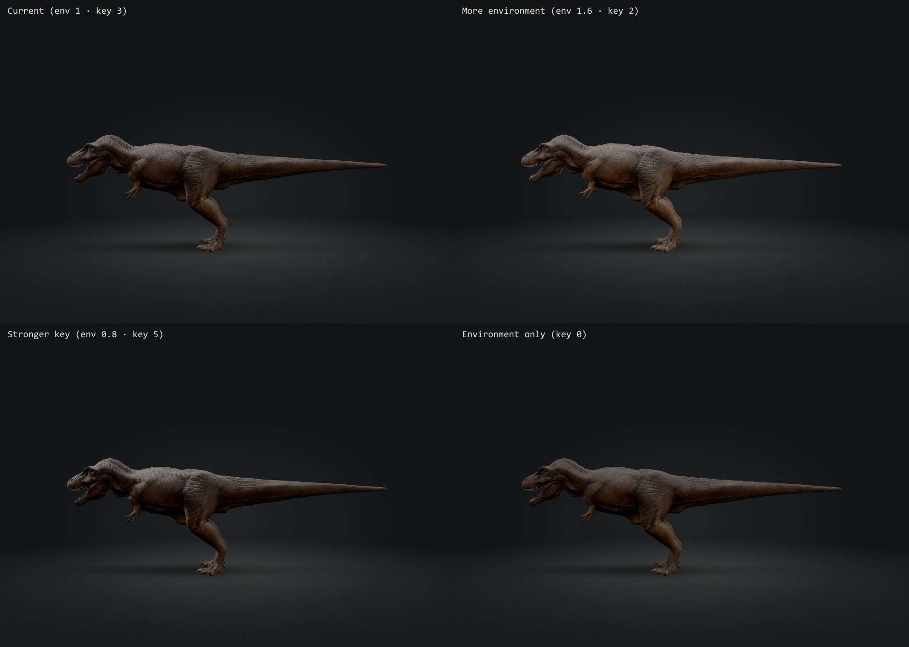
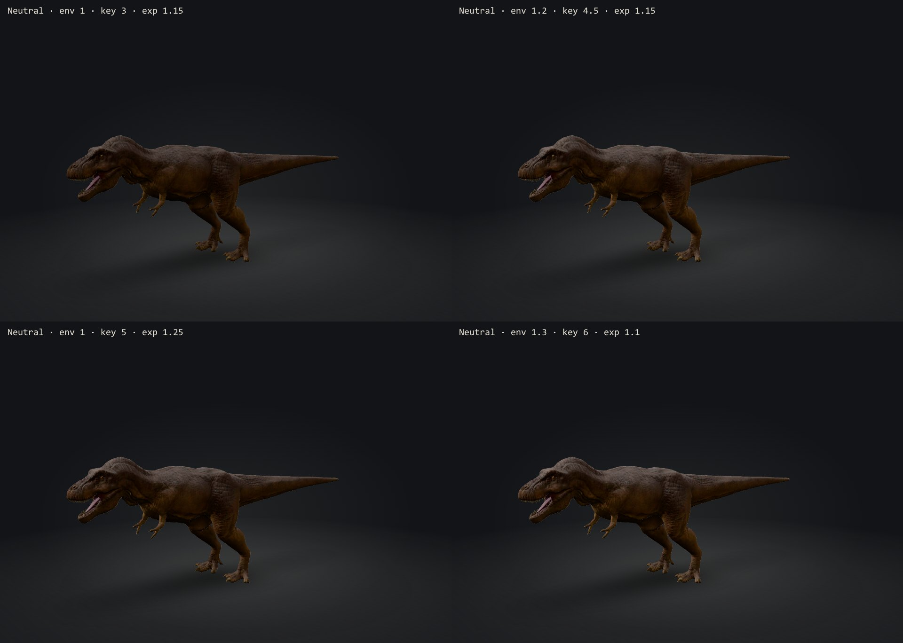
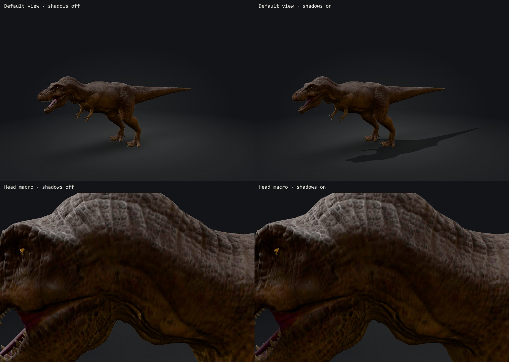
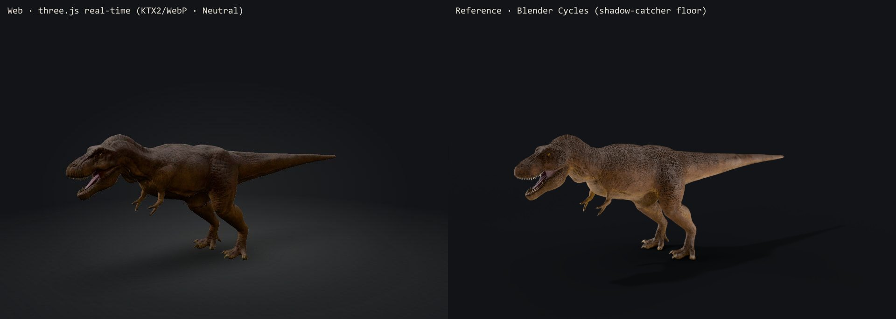
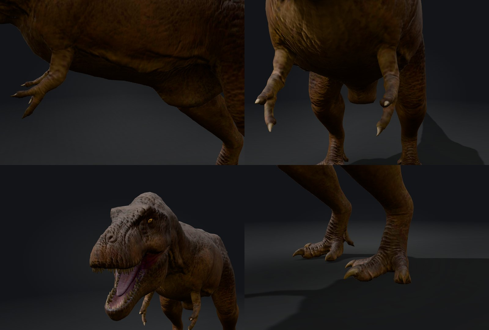

# Lookdev — *Tyrannosaurus rex* (Phase 4)

Asset: "Tyrant King – Tyrannosaurus" by Marcel Schanz, CC BY 4.0 (see `../asset-research.md` §6).
Date: 2026-10-16. Renders: headless Chromium + SwiftShader (true three.js output; GPU-specific texture formats may differ on real hardware) and Blender 5.1 Cycles.

Reproduce:

```
npx next dev -p 3300
node scripts/lookdev.mjs --base http://localhost:3300            # all sheets → docs/lookdev/img/
blender --background --factory-startup --python scripts/blender/reference_render.py -- \
  --input assets-src/trex/work/tyrannosaurus-rex.glb --output .lookdev/cycles-default.png \
  --camera 12.5,4.6,11 --target 0,2.9,0.4
```

## 1. Texture encoding




| Option (desktop, 2K) | Download | Est. GPU textures | Verdict |
|---|---|---|---|
| All WebP (Phase 3) | 4.02 MB | ~84 MB | Good quality; raw RGBA in GPU memory |
| KTX2, UASTC normals | 7.93 MB | ~21 MB | Same quality as WebP; normal map alone is 4.6 MB |
| KTX2, ETC1S normals | 3.49 MB | ~21 MB | **Rejected** — 4×4 block artefacts read as stair-stepped lighting (neck, thigh) |
| KTX2 4K | 23.5 MB | ~71 MB | Marginally crisper scales near the eye; not worth 6× the download |
| **KTX2 ETC1S + WebP normals (chosen)** | **4.09 MB** | **~35–42 MB** | Same download as WebP, about half the GPU memory, no visible loss |

Notes:
- gltf-transform deliberately skips UASTC rate-distortion optimisation for normal maps (it bends normal directions), so UASTC normals cannot be made smaller. Verified by running `ktx create` directly: without RDO the output is byte-identical to the pipeline's.
- The Basis transcoder is a one-time, cacheable 253 KB (gzip) download shared by every species.
- A UV seam is visible on the flank in every variant — a source-asset limitation.

## 2. Tone mapping



**Chosen: Khronos PBR Neutral.** It reproduces the artist's albedo hues; AgX greys the warm browns, ACES adds contrast and saturation. Neutral was designed for faithful base colour, which matches a specimen viewer — colour here is an artistic interpretation (see appearance notes), so it should at least be shown as painted.

## 3. Texture-map contribution



All maps earn their cost: without the normal map the scales disappear; AO deepens jaw and neck folds; the roughness map breaks up an otherwise uniform matte sheen.

## 4. Lighting and shadows





**Chosen:** environment 1.2, key light 4.5, exposure 1.15, plus a **key-light shadow map rendered once** (specimen and lights are static, so orbiting costs only the shadow lookup in the shader).

## 5. Web vs. Cycles reference



Light units differ between Blender (watts) and three.js, so absolute brightness is not comparable. What the comparison shows:

| Difference | Cause | Fixed in Phase 4? |
|---|---|---|
| No self-shadowing or cast shadow on the web | Real-time renderer had IBL + contact shadow only | **Yes** — one-shot key-light shadow map |
| Web skin darker | Baked AO map (mean 0.61) multiplies image-based light; Cycles ignores the map and computes real occlusion | Accepted — physically correct for a real-time renderer; compensated by lighting balance |
| Warmer highlights in Cycles | Pipeline drops `KHR_materials_specular` (specular colour layer) | Accepted — saves a 2K texture and `MeshPhysicalMaterial` cost |
| Crisper scale contrast in Cycles | Path-traced GI and soft area lights | Partly (Neutral tone mapping, stronger key); the remainder is inherent to real-time rendering |

**Conclusion:** the source asset holds more quality than the Phase 3 web render showed; most of the gap was renderer configuration and is now closed.

## 6. Anatomy review



Observations about the **model**, to be checked against sources in Phase 5 before anything is stated to visitors:

| Feature | Observation | Status |
|---|---|---|
| Posture | Horizontal back, tail held clear of the ground | Consistent with modern reconstructions — verify and cite |
| Feet | Three main toes plus a small inner dewclaw | Consistent — verify and cite |
| Forelimbs | Side view appears to show **three clawed digits** on one hand | *T. rex* is usually reconstructed with two functional digits — verify count and, if confirmed, remove the extra claw in Blender |
| Mouth | **No lip tissue**; all teeth exposed in a wide gape | Lip coverage in tyrannosaurs is an active research question — present as uncertain; candidate appearance note |
| Integument | Uniform large tubercles over the whole body | Compare with published skin-impression evidence — appearance note |
| Pose | Fixed, open-mouth pose; no rig | Asset limitation; idle animation would need rigging |

## 7. What rendering can fix vs. what needs a better asset

| Fixed by rendering (done) | Needs asset work or a better source |
|---|---|
| Tone mapping, exposure, light balance | Lipless mouth and exposed teeth (sculpt work; scientifically uncertain either way) |
| Self-shadowing and cast shadow | Possible extra forelimb digit (small Blender mesh fix if confirmed) |
| Texture encoding and GPU memory | UV seam on the flank |
| First-interaction stall (shader/texture warm-up) | Single static pose, no rig |
| | 2014 sculpt; dated skin interpretation |

**Recommendation:** keep this asset for the MVP with honest appearance notes, fix the forelimb digit in Blender if Phase 5 confirms it, and keep watching for a better-licensed, more current *T. rex* model.
